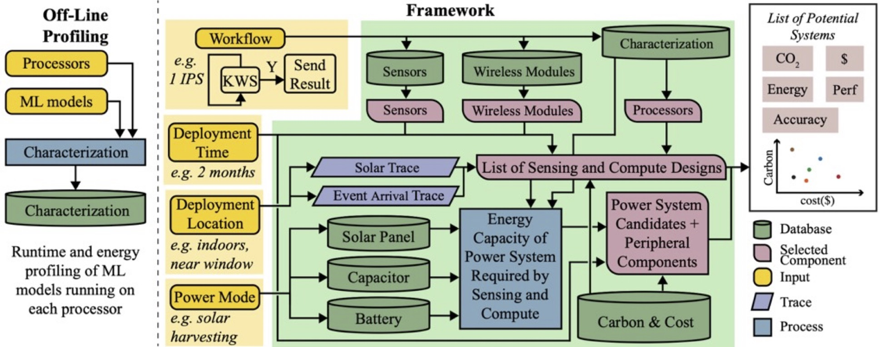

By 2030, we envision a world where intelligent edge devices will be ubiquitous, impacting our daily lives in various ways. Spanning a wide spectrum, from energy-harvesting devices (e.g., sensors, backscatter tags) to more sophisticated platforms including mobile phones, wearables, and even small drones, edge devices will provide accessibility and critical health and wellness applications to many communities. The increasing sophistication and capabilities of these devices, primarily fueled by advancements in artificial intelligence and hardware efficiency, will lead to a dramatic rise in the number of intelligent edge devices deployed.

Given their growing ubiquity, we must consider the environmental impact of edge devices. Information and communications technology is responsible for up to 4% of worldwide emissions, equivalent to the aviation industry’s carbon footprint. User and edge devices are responsible for more than one-third of this carbon footprint. This environmental impact is expected to worsen as the number of edge devices (i.e., IoT devices, sensors, consumer devices) is projected to increase from nearly 100 billion to trillions.

The significant improvements in performance and energy efficiency over the last two decades remain insufficient to reduce the environmental impact of computing devices. First, in terms of carbon emissions, the operational emissions resulting from energy consumption over a device’s lifetime are only a fraction of its impact; the embodied carbon emitted during the production of computing devices plays a more significant role. Moreover, most edge devices are equipped with computational resources and batteries that exceed their lifetime and use case needs, leading to significant amounts of wasted carbon emissions, particularly embodied emissions. Finally, the environmental impact of edge devices extends beyond carbon emissions to include e-waste from discarded electronics, the toxicity of materials used for integrated circuit (IC) and battery fabrication, and the water consumed during IC manufacturing.

We explore a number of projects within this domain, including envisioning new devices that are more sustainable, new power sources for energy harvesting, and encouraging users to rethink use of carbon and water in large scale ICTs.

## Carbon-Aware System Design for Edge Devices

This project seeks to make carbon and sustainability a first-order design parameter for future edge computing devices that range from tiny, energy-harvesting Internet of Things (IoT) devices to higher-performance consumer electronics. Delphi is a suite of carbon-aware design tools that consider factors like energy, e-waste, and water usage from the manufacturing of computational devices, as well as operation carbon factors of machine learning and software lifecycles. The framework covers sensors, computing, communication, and power, accommodating various edge devices, and includes probabilistic analysis of machine learning workflows design and their operational and embodied carbon impact. 

The project's research has three major tasks. First, quantifying device environmental impact by collecting a first-of-its-kind dataset via a state-of-the-art academic clean room, the Cornell Nanoscale Facility (CNF), with architectural carbon models for salient device components (e.g., processor, memory and storage, energy harvesting modules). This task integrates data into new foundational carbon models, guiding all research tasks. Second, tools for the design of systems with sustainability as a first-order design target, alongside performance and quality of service. The task develops Electronic Sustainability Records for devices on the Pareto-frontier to maintain system-specific sustainability ledgers to track environmental telemetry across the operational lifetime of devices. Finally, the third task develops runtime sustainability managers, including humans in the loop, to reduce device obsolescence. The software will gracefully degrade and upgrade system performance based on user choices, static lifetime requirements, and environmental factors. The comprehensive framework's effectiveness is demonstrated through short-lived "Ephemeral devices" and lifelong companion health and wellness wearable devices, nicknamed the "Infinite Bit." These two device archetypes provide a mechanism for continuous validation as the project matures.

Carbon optimization must also occur before devices are deployed. Hardware selection, power subsystem configuration, deployment location, and workload characteristics all influence both embodied and operational emissions.
To address this, we are developing a carbon-aware system design framework that connects component characterization, environmental traces, and workload requirements into a unified exploration process.

The framework integrates processor and ML profiling, sensing and wireless modules, and alternative power architectures such as solar panels, capacitors, and batteries. It incorporates deployment-specific factors — including location, energy availability, and expected lifetime — to evaluate candidate configurations across carbon footprint, cost, and system capability.
By explicitly modeling embodied and operational emissions across the stack, this approach enables designers to move beyond generic, over-provisioned hardware and instead select system configurations aligned with environmental goals and real-world constraints.

- [From Component to System: Rethinking Edge Computing Design through a Carbon-Aware Lens](https://dl.acm.org/doi/abs/10.1145/3757892.3757910). ACM HotCarbon (2025)
- [Learn more at this press release](https://research.gatech.edu/nsf-grant-develop-carbon-nutrition-labels-sustainable-internet-things)
- [See the funding page for GT at this site](https://www.nsf.gov/awardsearch/showAward?AWD_ID=2324861&HistoricalAwards=false)

## Carbon-Aware Services: Leveraging Latency for Sustainability

 our study reveals
opportunities to relax latency requirements of services based on user feedback; this feedback is application-
specific, with ChatGPT having the most favorable eco-feedback tradeoff. Further system studies suggest lever-
aging the reduced latency can bring down the carbon footprint of an average service request by 93.1%.")

While much of the environmental impact of computing is embedded in infrastructure, user-facing services also present opportunities for carbon-aware optimization. Modern cloud systems are typically engineered to minimize latency at all costs. However, modest flexibility in response time can unlock meaningful reductions in operational carbon.

When users permit small increases in response time, requests can be redirected to renewable-powered data centers, processed in larger batches, or executed with improved hardware utilization. These mechanisms increase infrastructure efficiency and enable renewable energy scheduling, reducing per-query emissions without fundamentally degrading user experience.
This work demonstrates how interaction design and system-level scheduling can work together to enable carbon-aware service provisioning.

- [Slower is Greener: Acceptance of Eco-feedback Interventions on Carbon Heavy Internet Services](https://dl.acm.org/doi/abs/10.1145/3723038). ACM Journal on Computing and Sustainable Societies (2025)

- [Empowering Users to Make Sustainability-Forward Decisions for Computing Services](https://dl.acm.org/doi/abs/10.1145/3725979). Communications of the ACM (2025)

## Biodegradable Devices and Additive Manafacturing



Environmental impact does not end at energy consumption. As edge systems scale globally, material choices and end-of-life pathways become equally critical.

We explore fully recyclable electronic platforms designed to reduce waste at the source. By replacing conventional epoxy-based circuit substrates with water-soluble structural materials and reusable conductive traces, these systems allow electronic components and conductive materials to be recovered without destructive recycling processes. This approach rethinks prototyping and small-scale electronics manufacturing to enable circular design principles in computing hardware.

- [DissolvPCB: Fully Recyclable 3D-Printed Electronics Using Liquid Metal Conductors and PVA Substrates](https://dl.acm.org/doi/abs/10.1145/3746059.3747604). UIST (2025) **Best Paper Award**



<!--
## Spintronics

We have been exploring the promise of spintronic memories and devices for ultra small intermittent computing platforms with [Prof Pedram Khalili](https://www.mccormick.northwestern.edu/research-faculty/directory/profiles/khalili-pedram.html) and the PERL Laboratory.

Recently we have been funded by the NSF to develop timekeepers for intermittent computing.

This project seeks to advance the state-of-the-art in timekeeping for low-power, battery-free, energy harvesting embedded systems. These systems must perform computation and sensing tasks across multiple, frequent power failures. This intermittent operation requires a strong sense of time to ensure no energy is wasted and computed results are not stale. Existing timekeepers (i.e. real-time clocks) require significant amounts of energy to turn on and operate, are relatively large (millimeter scale), are slow to restart, and use energy proportional to the length of a power failure (which can be impractically long). This project takes advantage of the unique properties of emerging nano-scale non-volatile magnetic random-access memory (MRAM) devices, particularly adjustable data retention length, to create orders of magnitude lower power, adjustable, ultra-small timekeeping devices. A system can set a few bits of the timekeeper and check them later to see which ones have lost information. By tailoring each bit, or array of bits, to particular lengths of time, the system can measure time regardless of whether a power failure occurred. Such a timekeeper requires the same amount of energy if it times an outage of one second, one day, or one year, with arbitrary accuracy depending on the number and characteristics of the magnetic elements used. The project cuts across the system stack to realize the benefits of this timekeeper; exploring circuit designs, architectural, and system paradigms to embed this new timekeeping device in the context of intermittent computing: as an alternative to a runtime clock, an interrupt source, a data and input/output (I/O) controller, and as an expiring memory allocator. These modules are made available to application developers to enhance the timeliness of their programs.

The technologies developed in this project will enable more efficient and accurate timekeeping for an important emerging class of computer systems. Batteryless and energy harvesting computing devices offer a more sustainable future for the Internet of Things and enable numerous health, agriculture, and intelligent infrastructure applications. The elimination of batteries in remotely powered sensors will mitigate the growing waste stream resulting from battery wear out and replacement. The fabrication and eventual distribution of the devices and systems from this project will provide a more accurate timekeeping module for future batteryless systems, enhancing the reliability, security, and timeliness of batteryless systems. The resulting tools and experimental results will enable robust cross-stack simulation for battery-free devices and fabrication methods for magnetic memory devices. Outcomes of this project will be integrated into several ongoing outreach activities that expose K-12 and undergraduate students to the usage and application of embedded computing. This effort will train graduate students in essential skills across computing, materials, and physics and engage them in mentoring, teaching, and outreach activities via GoBabyGo!– where students help build power wheelchairs from ride-on toy cars for children with mobility issues.

[NSF-BSF: CNS Core: Small: Reliable and Zero-Power Timekeepers for Intermittently Powered Computing Devices via Stochastic Magnetic Tunnel Junctions
](https://www.nsf.gov/awardsearch/showAward?AWD_ID=2106562).

-->

## Soil Powered Computing
Human-caused climate degradation and the explosion of electronic waste have pushed the computing community to explore fundamental alternatives to the current battery-powered, over-provisioned ubiquitous computing devices that need constant replacement and recharging. Soil Microbial Fuel Cells (SMFCs) offer promise as a renewable energy source that is biocompatible and viable in difficult environments where traditional batteries and solar panels fall short. However, SMFC development is in its infancy, and challenges like robustness to environmental factors and low power output stymie efforts to implement real-world applications in terrestrial environments. This work details a 2-year iterative process that uncovers barriers to practical SMFC design for powering electronics, which we address through a mechanistic understanding of SMFC theory from the literature. We present nine months of deployment data gathered from four SMFC experiments exploring cell geometries, resulting in an improved SMFC that generates power across a wider soil moisture range. From these experiments, we extracted key lessons and a testing framework, assessed SMFC’s field performance, contextualized improvements with emerging and existing computing systems, and demonstrated the improved SMFC powering a wireless sensor for soil moisture and touch sensing. We contribute our data, methodology, and designs to establish the foundation for a sustainable, soil-powered future.

[Terracell](https://terracell.org/) is a soil-powered, battery-free sensing platform developed in the Ka Moamoa Lab to enable long-term, maintenance-free environmental monitoring. By harvesting energy directly from electrochemical gradients naturally present in soil, TerraCell transforms the ground itself into a sustainable power source for embedded systems. The platform integrates ultra-low-power hardware, adaptive energy-aware computing, and resilient data logging to operate under highly intermittent energy conditions—eliminating the need for batteries in remote deployments. Designed for applications ranging from regenerative agriculture and forest health monitoring to Indigenous-led environmental stewardship, TerraCell embodies our vision of sustainable, place-based cyberinfrastructure: computing systems that live with the land rather than extract from it.


