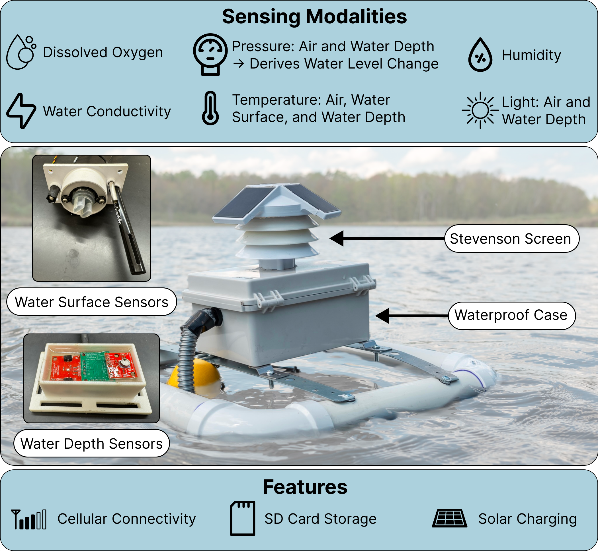
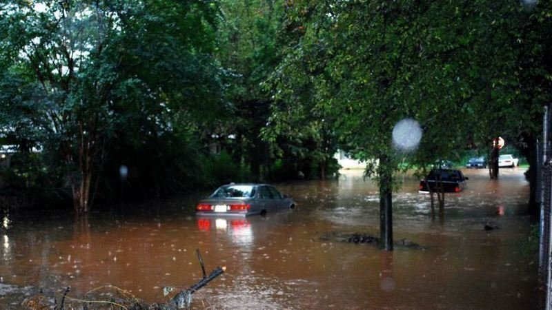

---
# Date this page was created.
date: 2020-10-27T00:00:00

# Project title.
title: "Sustainable and Indigenous Cyberinfrastructure"

# Project summary to display on homepage.
summary: "Co-designing sensor networks, and educational tools, and other digital systems with Indigenous and other local communities to address goals around environmental justice, civic action, and self-sufficient agriculture."

showHero: false
showTableOfContents: true

---

The Ka Moamoa lab draws upon the knowledge and practices of many Indigenous cultures to promote sustainable and community-oriented environmental sensing. We take a relational view on these projects, aiming to build longterm, reciprocal partnerships with Indigenous nations and community organizations. We pride ourselves in designing and deploying robust cyber-physical systems with our partners, meanwhile remaining mindful of the big picture role that computing systems can play within their broader socio-political contexts. The Ka Moamoa lab strives to implement actionable and reciprocal systems that meet the challenges of a rapidly changing world.

## Makak: Tribally-Engaged Water Quality Sensing 

As part of the STRONG Manoomin collective, the Makak project applies sovereignty-centered co-design methods to resilient environmental cyberinfrastructure hardware, supporting Indigenous Ojibwe water stewardship and conservation. The Ojibwe word for “container”, Makak aims to understand the conditions experienced by manoomin (wild rice), a culturally and ecologically significant plant that grows in water bodies in the Great Lakes region and faces a heightened risk from a rapidly changing environment. Grounded in long-term reciprocal relationships, the project moves beyond conventional research paradigms by collaboratively determining what modalities should be measured, how data should be handled, and who governs its use. Through workshops with Tribal Natural Resource elders, shadowing ongoing conservation efforts, and iterative seasonal deployments, the Ka Moamoa lab co-developed low-cost sensing buoys aligned with partners priorities around manoomin (wild rice) conservation, water quality, and sovereignty. 
From the technical perspective, Makak builds on advances in low-cost sensing, measuring the 10 environmental modalities described in the figure below. The system integrates solar-powered energy harvesting, cellular connectivity, edge computing, and modular environmental sensors into a durable, field-deployable platform. Over the 2024 and 2025 summer seasons, we have deployed 29 Makak buoys with Tribal and other conservation partners to provide realtime data about Ojibwe sovereign lands. Together, the co-design framework and resilient hardware platform demonstrate how community-engaged cyber-physical systems can advance both technical innovation and Indigenous-led environmental stewardship.

## Noondawind: A Digital Dashboard for Environmental Stewardship and Tribal Sovereignty

Noondawind is a community data sharing platform designed to support environmental stewardship and data sovereignty for Ojibwe communities in the Great Lakes region. Co-created through long-term partnerships, this project aims to integrate Ojibwe Knowledge with environmental sensing data, community resources, and relevant policy information to support a community-centered platform to drive action. Rather than treating data as neutral or extractive, Noondawind foregrounds relational accountability—ensuring that environmental monitoring, visualization, and data sharing tools reflect partner Nation priorities, cultural values, and intergenerational responsibilities, particularly around the protection of Manoomin (wild rice) and freshwater ecosystems.

The project contributes both a working cyberinfrastructure system and a design framework for sovereignty-affirming technologies. Through participatory design, community workshops, and iterative prototyping, Noondawind demonstrates how data platforms can move beyond technical reporting tools to become instruments of self-determination, decision-making, and seventh-generation stewardship. By centering Indigenous governance, cultural knowledge, and long-term ecological care, the project offers a model for how computing systems can strengthen—not undermine—tribal sovereignty and environmental resilience.

 Makak buoys: low-cost environmental sensors deployed across the Great Lakes. Makak buoys are a key source
of data in Noondawind. (2) Manoomin harvesting: seasonal gathering of wild rice. (3) Community co-design: collaborative
workshops with Ojibwe partners and other stakeholders. (4) Noondawind interactive sensor data visualization d) Noondawind
Policy Resources page")

The Makak and Noondawind projects are supported by:
 * Strengthening Resilience of Ojibwe Nations Across Generations (STRONG) NSF Smart and Connected Communities Award 2233912
 * Focused CoPe: Strengthening Resilience of Manoomin, the Sentinel Species of the Great Lakes, with Data-Science Supported Seventh Generation Stewardship: NSF Coastlines and Peoples Award “Focused CoPe: Strengthening Resilience of Manoomin, the Sentinel Species of the Great Lakes, with Data-Science Supported Seventh Generation Stewardship”, #2209226.

## Community-driven Urban Flood Reduction through Sewer Infrastructure Advocacy

Peoplestown Community Floodwatch is a community-led research partnership focused on addressing chronic combined sewer overflows (CSOs) in Atlanta’s Peoplestown neighborhood. For decades, heavy rains have caused untreated wastewater to flood into residents’ homes, yards, and nearby waterways, creating urgent public health and environmental justice concerns. In collaboration with local leaders, including the Peoplestown Revitalization Corporation, Peoplestown Neighborhood Association, Georgia WAND, Science for Georgia, and the South River Watershed Alliance, our team pairs participatory action research with technical innovation to support resident-led advocacy for long-term infrastructure solutions.

Through storytelling workshops, co-design sessions, and collaborative data analysis, we are building a community-centered flood dashboard and policy advocacy toolkit that aggregates flood maps, planning data, consent decree documents, and lived experiences. These tools will help residents engage city, state, and federal decision-makers to advocate for upstream stormwater retention and equitable infrastructure investment. By strengthening both technological infrastructure (data visualization and modeling) and social infrastructure (relationships, organizing, and civic engagement), the project elevates local voices in advocating for clean water, community health, and environmental resilience in Peoplestown while creating a model for community-driven environmental decision-making nationwide.

## Applying Indigenous Relationality to Computer Science Education

We reimagine how children engage with computing by grounding technology design in Indigenous methodologies of relationality. Rather than prioritizing technical proficiency or isolated learning outcomes, the project positions systems design as a form of stewardship—where relationships with land, materials, and community are central. Through a multi-phase Research–Practitioner Partnership spanning public science festivals, a tribal technology showcase, and a youth engineering internship, we developed tangible user interfaces (TUIs) that transform organic materials—such as fruits, leaves, and cedar bark—into interactive musical and digital systems. By merging the Engineering Design Process with Indigenous frameworks for relational equity and sovereignty, the work demonstrates how technical rigor and cultural accountability can be co-constitutive rather than oppositional.

Across these deployments, youth moved from curious users to sovereign designers—adapting and reimagining the systems for environmental storytelling, generative art, and mental health interventions. The project offers both a working set of relational technologies and a methodological roadmap for Child-Computer Interaction that centers care, reciprocity, and ecological identity development. By treating design as ceremony and technology as a relational mediator rather than a neutral tool, this work provides a scalable model for fostering environmental stewardship, youth agency, and community-rooted innovation through computing.

")

<!-- ## Smart Green Infrastructure

With Argonne National Lab and researchers across McCormick engineering departments (Aaron Packman, George Wells, Jennifer Dunn, Bill Miller and others) we have been exploring how sensors, computing systems, and artificial intelligence / machine learning can be applied to critical problems in sustainable urban systems. We have been exploring novel energy supplies for ultra long term sensing, and how large scale sensor infrastructure can be enhanced to provide ways for citizens to engage in the scientific process and support resilient cities and coastlines.

*This project is located at Northwestern University and sponsored by the [National Science Foundation under award #2038853](https://www.nsf.gov/awardsearch/showAward?AWD_ID=2038853)*

Cities across the nation have invested significantly in making infrastructure smarter, more sustainable, and more resilient to extreme weather events. Green infrastructure (GI), a general term for planned installations of trees, plants, soils, wetlands, and other natural resources, is increasingly being installed in cities nationwide to provide resilience to flooding, sewer overflows, urban heat, air pollution, habitat loss, and coastal erosion, that are overwhelming traditional infrastructure and negatively impact urban life. Embedding smart devices in GI provides numerous benefits to a city, providing insight into the health and effectiveness of the system, and the operations and fitness of the city. However, deploying smart devices in GI is challenging because of the scale and need for long-term deployment, meaning battery-powered or expensive plugged-in devices are not feasible. This project builds Smart Green Infrastructure; augmenting GI with battery-free smart devices, powered by energy harvested directly from soil, which gather data, infer, actuate, and collaborate with each other. By harvesting from freely available soil and removing batteries, these devices can last for decades. Through partnerships with organizations in Chicago, Illinois–The Nature Conservancy, the Chicago Botanic Garden, and the Lincoln Park Zoo–the project demonstrates applicability by tackling stormwater management, urban wildlife surveillance, green roofs and other real-world applications. . Beyond cities, the work in this project will enable new applications in agriculture and smart farming, water resources management, and any applications where long term, zero maintenance embedded intelligence is required.

Building Smart GI presents cyber-physical systems challenges in enabling robust inference, communication, and coordination on ultra-constrained computing platforms, and despite frequent power failures and dynamic energy availability. These devices harvest energy from soil or plant organic matter using terrestrial Microbial Fuel Cells (MFCs), constructed from inert materials providing decades long lifetime. These devices use machine learning to understand their environment, enabling robust, long-term monitoring that requires no maintenance or replacement. Finally, these devices actuate to "heal" the surrounding environment, switching the MFC from energy generation, to producing a disinfectant instead with the microbial community. A high-powered edge device orchestrates the actions of the swarm of MFC powered nodes, making decisions based on network data and external factors like user tasks. Project tasks include; co-design of the Terrestrial MFC and corresponding energy model for efficient and dynamic energy harvesting and; development of a tiny, resilient computing platform that harvests soil energy and supports sensing, and actuation; creation of a framework for conducting on-device machine learning to recognize subtle environmental changes from lossy data; exploration of orchestration of a network of intermittently powered devices; and conducting a series of end-to-end deployments with Chicago institutions.

<iframe width="100%" height="400" src="https://www.youtube.com/embed/jw8Ow8lWRTE" title="YouTube video player" frameborder="0" allow="accelerometer; autoplay; clipboard-write; encrypted-media; gyroscope; picture-in-picture" allowfullscreen></iframe>

## Indigenous Led Cyberinfrastructure

The Northwestern University campus sits on the ancestral homelands of the people of the Council of Three Fires: the Ojibwe, the Potowatomi, and Odawa, as well as the Menominee, Miami, and Ho-Chunk Nations. 

An interdisciplinary team of researchers including PI Hester and Northwestern Engineering faculty has been awarded a grant to address challenges faced today by the Ojibwe Nations. 

As part of the [Civic Innovation Challenge](https://www.nsf.gov/news/special_reports/announcements/021721.jsp), led by the US National Science Foundation (NSF) in partnership with the US Department of Energy and US Department of Homeland Security, the team received $50,000 in funding for its project, [“Strengthening Resilience of Ojibwe Nations across Generations (STRONG): Sovereignty, Food, Water, and Cultural (in)Security.”](https://www.nsf.gov/awardsearch/showAward?AWD_ID=2044053&HistoricalAwards=false)

 
The project’s vision is to co-create methods with Ojibwe communities that integrate traditional ecological knowledge with data science, environmental science, social science, and engineering platforms to strengthen future Ojibwe generations’ resilience. Using a sovereignty-affirming approach that advances cultural, food, and water security, the researchers will co-develop monitoring, prediction, and response systems and decision-making tools for strengthening resilience to natural disasters and other environmental threats. See our summary video starting at nine minutes, below.

<iframe src="https://player.vimeo.com/video/569023605?h=19214e8871" width="640" height="360" frameborder="0" allow="autoplay; fullscreen; picture-in-picture" allowfullscreen></iframe>

## Coastlines and People Hub: Manoomin

We participated in the CIVIC inovation challenge, and have continued our work with Ojibwe nations building cyber infrastructure, including proposing a new Coastlines and People Hub. 

The Hub Vision is to develop cyber, scientific, and community foundations to ensure 7th generation sustainability of the Western Great Lakes. We bring together tribes, conservationists, and researchers around manoomin (wild rice) as a pillar of Ojibwe culture and livelihood, and as a keystone sentinel species for understanding and conserving Great Lakes coastal wetlands.

## Accessibility Technology

Partnering with physicians and researchers at Northwestern Medicine, we have been developing and understanding technolgoy to aid low mobility children through low cost mechanical and techonlogical augmentation of toy ride-on cars, with the GoBabyGo! program. Check out our ACM CHI 2020 Late Breaking Work on the topic: ["I Am Not an Engineer": Understanding How Clinicians Design & Alter Assistive Technology.](https://josiahhester.com/cv/files/gobabygo-chi2020.pdf)

## Wildlife Tracking and Conservation

Our lab has a history of supporting wildelife and consevation tracking applications ranging from desert tortoise tracking to otter rehabilitation. We have recently partnered with Lincoln Park Zoo to explore building a network of sensors to monitor wildlife across North america, using in-situ machine learning techniques and low power, low cost platforms to count animals. We have also started collaborating with the San Diego Zoo on understanding and monitoring eating habits for large animals. -->
