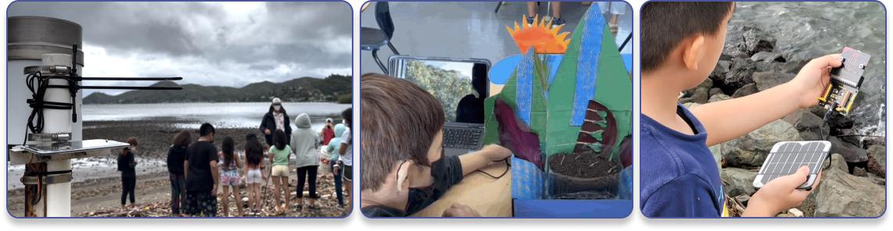
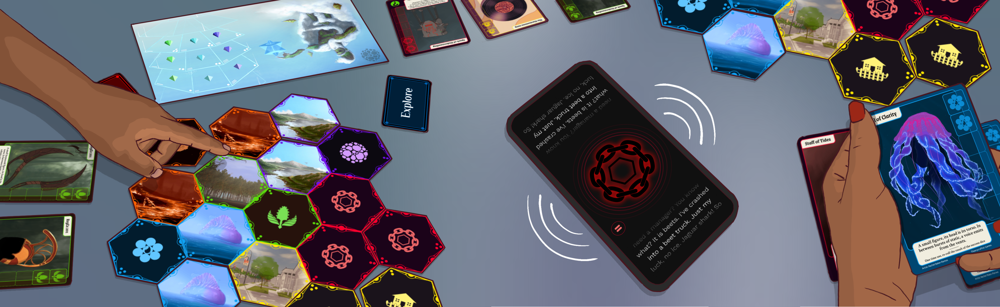

Ka Moamoa Lab’s education work is rooted in a simple commitment: powerful computing and STEM learning should strengthen (not replace) learners’ relationships to place, language, culture, and community—especially in Indigenous educational contexts where mainstream curricula and “one-size-fits-all” edtech routinely fall short. Across our projects, we bring together educators, cultural specialists, and researchers in long-term partnerships that emphasize community engagement and co-design, so that the resulting lessons, tools, and infrastructures support culturally revitalizing teaching as it is actually practiced in schools and communities.

## **PLACES Education | Physical Computing for Place-based Education**

A major expression of this work is our collaboration with the Hawaiian-owned non-profit [Ulu Lāhui Foundation](https://ululahui.org/) through [PLACES Education (Place-based Learning and Culturally Engaged STEM)](https://www.places-education.com/). PLACES Education advances place-based and culturally revitalizing educational opportunities through professional development, innovative curricula, and the supporting resources and infrastructure that teachers need to sustain this work over time. 

In Hawaiʻi, PLACES specifically focuses on expanding access to place-based, culturally revitalizing computer science education across the islands—supporting teachers with professional development designed to build confidence in creating lessons that are locally grounded while also leveraging HIDOE‑approved AI tools responsibly. 

PLACES curricula are bilingual (ʻŌlelo Hawaiʻi and English) and are explicitly designed to ground CS learning in students’ lived experiences, local context, and Kānaka Maoli knowledge systems, including ʻāina‑based projects that connect computing skills to community benefit and environmental stewardship.

## **Kumu Connect | AI and Physical Computing for Place-based Education**

 in Hawaii to build culturally relevant, place based curricula, worksheets, and lessons for classrooms.")

These research insights have directly shaped how we build practical educational infrastructure, including [Kumu Connect, an AI lesson plan generator co-designed with Hawaiian immersion language teachers](http://kumuconnect.com). Kumu Connect is designed to generate standards-aligned, culturally relevant STEM lessons in both English and ʻŌlelo Hawaiʻi—explicitly responding to the reality that teacher shortages and limited resources disproportionately impact Indigenous and low-resource language settings, where educators are often forced to create materials from scratch while mainstream tools ignore cultural context. 

In practice, Kumu Connect asks educators to define instructional context (e.g., grade band, CS standards, language), then supports culturally grounded planning by offering cultural references (moʻolelo, ʻōlelo noʻeau, and cultural practices) with explanations of how they connect to the targeted CS concept. Teachers can further specify delivery modes (such as outdoors or low-tech), generate a complete lesson plan (objectives, activities, prompts, assessments), and then refine/edit before saving or exporting.

**Related Publications:**

* [**Kumu Connect: Design Thinking for Place-Based Generative Educational Technology in Hawaiian Immersion Schools**](https://doi.org/10.1145/3704637.3734781)  
* [**"I Would Never Trust Anything Western": Kumu (Educator) Perspectives on Use of LLMs for Culturally Revitalizing CS Education in Hawaiian Schools**](https://doi.org/10.1145/3706599.3720282)  
* [**"Those don't work for us": An Assets-Based Approach to Incorporating Emerging Technologies in Viable Hawaiian Teacher Support Tools for Culturally Relevant CS Education**](https://doi.org/10.1145/3653666.3656066)

## **Kaona | Game-based Learning through RPG Mechanics and Traditional Storytelling**

Lastly, we push forward tangible educational experiences through game-based and narrative-based mechanics, through efforts such as Kaona\*, a four-player tabletop Role Playing Game (RPG) and mobile “storyteller” app, designed to foster youth wellbeing from a *Kānaka Maoli* (Native Hawaiian) perspective, by introducing the values of *lōkahi* (harmony).

**\*Kaona can be defined as a hidden meaning, or double meanings that signify good or bad fortune. Inoa, or name, holds mana (spiritual power) and is important in identifying intention and purpose.**

The game takes place in post-apocalyptic *moku* (realms) that have fallen out of harmony, representing the six domains of the lōkahi wheel. Their environment, characters, and quests are inspired by Hawaiian *moʻolelo* (stories and legends), Hawai\`i’s history, and life experiences relatable to youth in Wai\`anae. 

Players work together to restore lōkahi in the moku by completing quests and healing corrupted rulers. Kaona’s storyteller app immerses players in the stories and guides first-time RPG players.

Kaona’s collaborative gameplay fosters skills in problem-solving, self-reflection, and community-building. The game’s moʻolelo, history, and place-based references enable players to mirror situations within their lives and develop approaches to navigate real-life challenges. 

**Related Publications:**

* [**Enabling Restorative Hawaiian Futurism via a Tabletop Role-Playing Game and Digital Ha‘i Mo‘olelo**](https://doi.org/10.1145/3665463.3678822)
