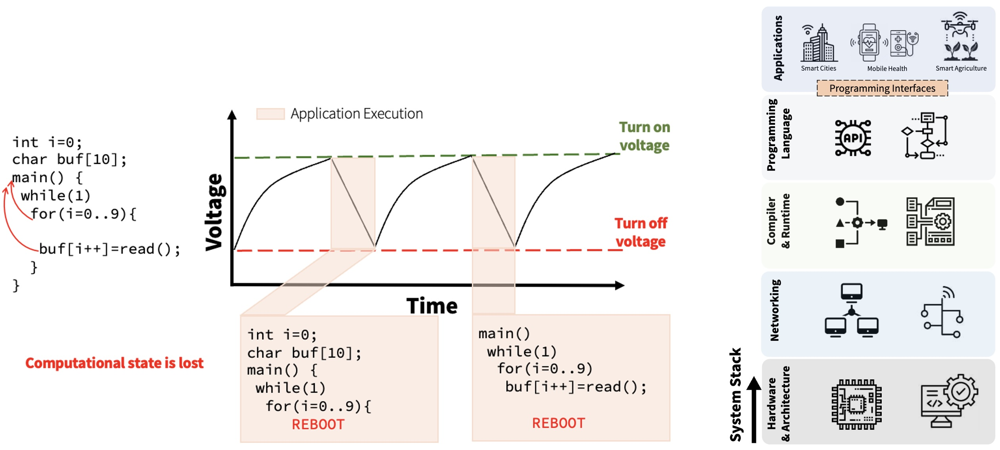
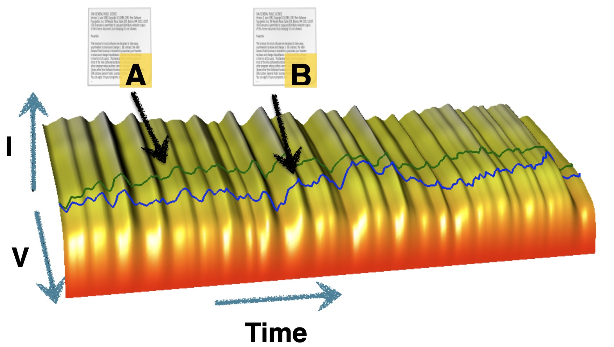
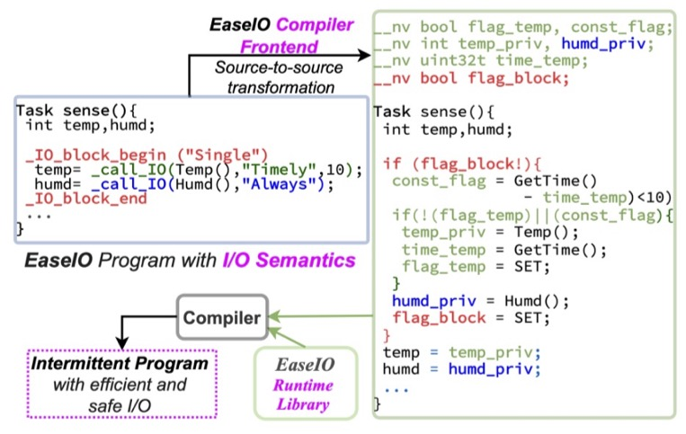

---
# Date this page was created.
date: 2020-12-22T00:00:00

# Project title.
title: "Intermittent Computing"

# Project summary to display on homepage.
summary: "Exploring how computing systems can be designed to function reliably when power is scarce, intermittent, or harvested from the environment. By treating power loss as a normal operating condition rather than a failure, intermittent computing enables long-lived, battery-free devices that support real-world applications in sensing, interaction, health, and sustainability."

showDate: false
showViews: false
DateUpdated: false
Author: false
Breadcrumbs: true
draft: false
showEdit: false
slug: "intermittent"
description: "Intermittent computing"
showHeadingAnchors: true
showPagination: true
invertPagination: false
showReadingTime: false
showTableOfContents: true
showWordCount: false
showSummary: false
showHero: false
---



Batteries are not a sustainable way to power the trillions of devices in the future Internet of Things (IoT). Only 5% of batteries in small electronics are recycled. The remaining ones are discarded and often end up in landfills, releasing toxic fumes and leaching chemicals into the soil as they break down. Mining for raw materials in batteries, like Lithium ("white gold"), has caused water insecurity for Indigenous communities as well as irreparable ecological damage. This collection of concerns has motivated me to explore how to build computing systems with lower ecological impact by leaving batteries behind and running off purely renewable energy harvesting sources. 

Battery-free embedded systems offer a transformative and ecologically sustainable approach for building the next trillion computing devices. Yet, system designers lack the hardware platforms, efficient runtime systems, and focused tools to build capable, data-intensive, reactive, and reliable applications on these devices. 

This project advocates for a future Internet-of-Things where the next trillion devices are battery-free, interact seamlessly with a user, sense, and infer large amounts of data in real-time, all to inform countless applications across societally essential domains. In this future, battery-free devices will be easy to program, straightforward to test and deploy, with scalable and capable hardware platforms and systems. 

**This project, generously funded from the [National Science Foundationʻs Faculty Early Career Development Program (CAREER)](https://www.nsf.gov/awardsearch/showAward?AWD_ID=2145584),** seeks to address these shortcomings, to fill the gap in hardware platforms, runtime systems, and tools for practical, dynamic, and capable applications on intermittently powered embedded systems.

## What is Intermittent Computing?

With no batteries, these devices must harvest energy from the environment which can be in any form e.g. RF, kinetic, thermal or solar. Since ambient energy is highly variable, these devices are never able to buffer enough energy to complete application execution in a single energy cycle. This causes frequent power failures and application execution is interrupted each time a power failure occurs as shown in the figure. 

  

Ka Moamoa lab focuses on enabling system support that cuts across the system stack by designing programming languages, compiler, runtime, and hardware support. The lab also actively looks for opportunities to work with healthcare workers and K-8 teachers from Native Hawaiian School to inform and validate the design of batteryless system support for real-world applications that a battery would not aid.  

## Batteryless Futures

What does a future trillion device Internet-of-Things look like, when devices interact seamlessly with a user, sense, and infer large amounts of data in real-time, to inform countless applications across societally essential domains?

**In this future,** battery-free devices will be easy to program, straightforward to test and deploy, with scalable and capable hardware platforms and systems. Programmers will have the tools to manage the volatility of energy harvesting and power failures and build resilient code for complex and practical applications that combine sensing, machine learning, and communication.  Developers will finally have confidence in a deployed battery-free embedded system.

Our work in the lab has invovled many threads over the past decade. In the past few years, as compute has gotten more abundant on edge devices, we now design with three guiding insights:

1. **Leverage hardware heterogeneity and weave its benefits across the system stack.** We can overcome the energy-per-computation barrier keeping us from capable applications by using low-power accelerators and FPGAs. However, the intermittent systems support for this is nascent at best.
2. **Embrace energy-aware adaptation, dynamism, and approximation.** Energy harvesting is inherently dynamic; the applications that run off this energy should be scaling operations based on energy available instead of just giving up. We must create scalable and efficient runtime systems that work no matter the energy situation.
3. **Equip developers with a new generation of sophisticated tools.** Building applications that can scale computation across intermittent power failures, heterogeneous hardware, and dynamic energy are challenging. We must develop tools that give insights into energy generation and usage and show the many paths an application can take caused by dynamic energy availability.

**Task 1: Hardware and Systems-Support for Heterogeneity.** Accelerators are ubiquitous in high-performance mobile computing. Intermittent computing has not yet integrated specialized and general purpose hardware in a single platform due to the challenges stemming from heterogeneity and mixed memory volatility. This thrust builds a reconfigurable, modular, and deployment-ready hardware platform that embraces multiple computing forms—microcontroller (MCU), convolutional neural network accelerator (CNNA), FPGA, etc. _Recent progress includes devellpment of the [Protean modular hardware platform](http://protean.systems/)_

**Task 2: Language and Runtime Support: Sketchpoints and High-Level Programming.** Checkpoint costs for memory-intensive applications often exceed the energy budget. This makes it challenging to build data and memory-intensive or inference-focused applications with a high level of sophistication (i.e., millions of weights in a CNN versus thousands). The task explores alternative checkpointing methods. This task builds on these approaches to create efficient inference applications and transpilers for high-level programming languages for battery-free devices so that novices can program in scripting languages like Python, JavaScript, and Blocks. _See the  [Battery-free Makecode project](https://ka-moamoa.github.io/makecode-website/) upon which much of this task will be developed._

**Task 3: Developer Tools and Energy Insights.** Heterogeneity causes headaches in understanding where energy is being used and which computing elements are responsible for program tasks. This task builds tools for the simulation and emulation of scalable intermittent computing applications. 

**Integration–Deployment in the Real World.** The research tasks, education, and outreach activities are all integrated via real-world deployment, including to enable smart cities and remote conservation applications, and with with clinicians in various  Medical Schools to deploy mobile health devices (smart face masks, fitness trackers). 

 Below are a collection of works from the lab in the space, it is not comprehensive, but meant as an overview of the space. Please check our [Google Scholar](https://scholar.google.com/citations?user=EMYV8cEAAAAJ&hl=en) for the most up to date information! 

## Tools 

Reliable progress on intermittent computing requires tools that make energy variability observable, repeatable, and comparable across systems. Energy harvesting introduces novel behaviors that must be handled by computing devices (i.e. power failures and I/V dynamics). Tools can help programmers explore where and how programs will break, and enable richer debugging and design process.

### Ekho Emulator
[**Ekho: Realistic and Repeatable Experimentation for Tiny Energy-Harvesting Sensors**](https://github.com/PERSISTLab/ekho) introduced a mobile, general-purpose emulator that records real energy-harvesting conditions and faithfully replays them in the lab, enabling controlled, reproducible evaluation of intermittently powered devices. 

### REHASH Simulator
Building on this need for principled experimentation, [**REHASH** provides a complementary framework](https://dl.acm.org/doi/abs/10.1145/3478077) for systematically testing and characterizing and predicting (software only) energy-harvesting behaviors across hardware and software stacks, helping researchers move beyond ad hoc power traces toward rigorous, comparable intermittent system design.

## Hardware Platforms

Intermittent computing requires purpose-built hardware platforms because traditional microcontroller systems assume stable power and hide energy behavior behind opaque regulators and batteries. Research platforms for intermittent systems expose energy storage, voltage thresholds, and power domains as first-class, controllable elements, allowing precise experimentation with checkpointing, scheduling, and failure recovery. These hardware platforms are essential for validating new runtimes and programming models under realistic energy-harvesting conditions and for accelerating innovation in battery-free, energy-adaptive systems.

<video autoplay loop muted playsinline>
  <source src="media/ProteanAnimation v20_1.webm" type="video/webm">
  <source src="media/ProteanAnimation v20_1.mp4" type="video/mp4">
</video>

### Federated Energy Storage
Untethered sensing devices have, for decades, powered all system components (processors, sensors, actuators, etc) from a single shared energy store (battery or capacitor). When designing batteryless sensors that are powered by harvested energy, this traditional approach results in devices that charge slowly and that are more error prone, inflexible, and inefficient than they could be. Federated Energy partitions and prioritizes harvested energy automatically into multiple isolated smaller energy stores (capacitors), which simplifies task scheduling, enables efficient use of components with differing voltage requirements, and produces devices that charge more quickly under identical harvesting conditions than a traditional centralized approach.

### Flicker Prototyping Platform
Flicker is a a platform for quickly prototyping batteryless embedded, energy harvesting sensors. Flicker is an extensible, modular, “plug and play” architecture that supports RFID, solar, and kinetic energy harvesting; passive and active wireless communication; and a wide range of sensors through common peripheral and harvester interconnects.

### Timekeeping Circuit and System [ACM ASPLOS 2020]
We explored dynamic reconfiguration of remanence based timekeepers to facilitate more accurate timing of off periods. This system, BOTOKS, enables new applications like TDMA communication, from the enhanced timekeeping architecture and hardware platform. 

### [Protean [SenSys 2022]](https://dl.acm.org/doi/abs/10.1145/3599184.3599186)
Protean introduces a flexible system architecture for intermittent computing that dynamically adapts execution and energy management policies to changing harvested power conditions. Rather than relying on fixed checkpointing or static task models, Protean enables systems to reconfigure behavior at runtime to maximize forward progress, efficiency, and responsiveness under highly variable energy environments. This work advances the vision of adaptive, self-optimizing battery-free systems that can operate robustly in real-world conditions.

## Programming Languages
Intermittent computing fundamentally breaks the traditional assumption of continuous power, making conventional programming models unsafe and error-prone. Programming languages and runtimes for intermittent systems provide structured execution models—such as task boundaries, transactional memory semantics, and safe checkpointing—that guarantee forward progress and memory consistency across power failures. By elevating energy failure to a first-class abstraction, these language-level tools make battery-free and energy-harvesting systems practical, reliable, and accessible to developers. Some examples from our lab include: 

### Mayfly Programming Language [ACM SenSys'17]
Mayfly is a language and runtime for timely execution of sensing tasks on tiny, intermittently-powered, energy harvesting sensing devices. Mayfly is a coordination language and runtime built on top of Embedded-C that combines intermittent execution fragments to form coherent sensing schedules: maintaining forward progress, data consistency, data freshness, and data utility across multiple power failures. Mayfly makes the passing of time explicit, binding data to the time it was gathered, and keeping track of data and time through power failures.

### Intermittent Kernel [ACM SenSys'18]
InK is the first multi-threaded task based language for intermittent computing. With InK prioritized threads can be scheduled and dynamically executed including with timing constraints as in Mayfly.

### Automatic Checkpointing with Timekeeping [ACM ASPLOS 2020]
TICS presents an automated checkpointing system that instruments arbitrary C programs—including those with pointers and recursion—for safe intermittent execution. TICS preserves program state and forward progress across power failures while preventing subtle inconsistencies in memory and time caused by naïve checkpointing. We identify three classes of timing consistency violations and design TICS to explicitly detect and avoid them. Additionally, TICS supports lightweight compiler pragmas that allow developers to annotate time-sensitive data (e.g., expiring sensor readings), enabling the system to selectively roll back and refresh stale values while maintaining correctness.

## Networking

Networking intermittent devices is fundamentally challenging because communication protocols assume continuous power, stable clocks, and persistent state—assumptions that collapse under energy harvesting. Power failures disrupt link-layer handshakes, invalidate time synchronization, corrupt protocol state machines, and break end-to-end reliability guarantees. Unlike computation, which can often resume locally from a checkpoint, networking requires coordination across multiple nodes, making timing mismatches and partial transmissions especially costly. Protocol designs must treat power loss as a normal operating condition rather than an exception. We have a few explorations in this area:

### GreenTooth
[GreenTooth](https://dl.acm.org/doi/abs/10.1145/3649221) is a robust and energy-efficient wireless communication protocol designed specifically for intermittently powered, battery-free sensor networks. Because harvested-energy devices frequently lose power and struggle to maintain accurate time, traditional low-power wireless protocols perform poorly. GreenTooth addresses this by combining TDMA-style scheduling with ultra-low-power wake-up radios to enable lightweight, outage-resilient connections between multiple batteryless sensors and a receiver.

### AdaSens
[AdaSens](https://ieeexplore.ieee.org/abstract/document/9712501) is an adaptive framework that enables intermittently powered, energy-harvesting sensors to intelligently coordinate sensing, computation, and communication under highly variable energy conditions. Because battery-free devices face unpredictable outages and constrained resources, AdaSens dynamically scales workload and schedules tasks across nodes to maximize spatial and temporal scene coverage.