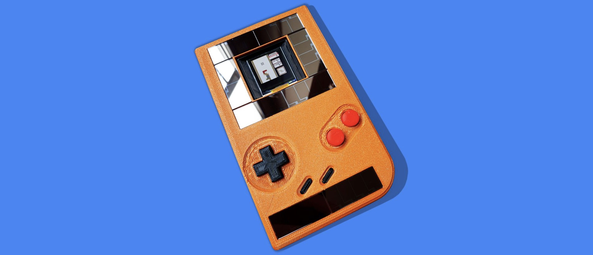
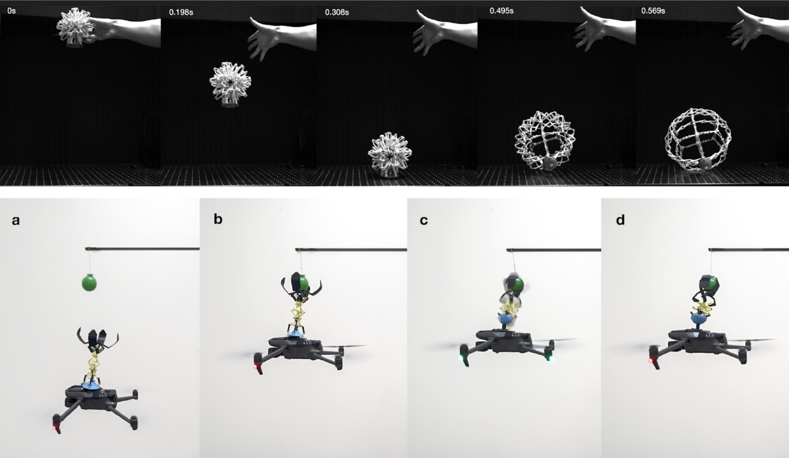

Sustainable technologies often rely on users to adapt — to monitor energy use, tolerate intermittency, or accept limited functionality. While these approaches are essential for reducing resource consumption, their success ultimately depends on how people live with them in everyday contexts.

Our work explores how interactive and playful design can support the adoption of sustainable systems by making environmental constraints tangible, intuitive, and engaging.

Across projects such as Battery-Free Game Boy, Kaona, DropPop, and Loofah Wearables, we design material and computational systems where environmental dynamics — including gravity, ambient energy, or mechanical deformation — are directly coupled with human interaction. Rather than operating as invisible background optimizations, these dynamics are experienced through unfolding structures, responsive materials, or energy-aware behaviors.

Playful interaction in this context is not ornamental. It provides a means for users to understand and participate in the operation of sustainable technologies through embodied engagement — whether by deploying passive infrastructure through simple physical gestures, interacting with intermittently powered devices, or sensing environmental input through soft material responses.

By making the operation of sustainable systems perceptible and interactive, we aim to support everyday use without requiring explicit behavioral compliance. In doing so, interactive and playful design can complement advances in low-power computing, passive mechanics, and material intelligence — helping sustainable technologies integrate more seamlessly into daily life.

## Drop to Deploy


DropPop is a passive, bistable deployable structure that explores how sustainable infrastructure can emerge through material intelligence and interaction. Each unit remains compact for transport and expands into a stable three-dimensional form when released, using stored elastic energy in bistable structural elements rather than motors or external power. This gravity-driven deployment enables structures to be distributed and activated through simple physical gestures, reducing reliance on powered logistics or complex installation processes. 

By coupling mechanical transformation with intuitive, embodied interaction, DropPop demonstrates how playful engagement with passive dynamics can support scalable, low-energy approaches to deployment and everyday use.

## Ecological Reflection: Loofah

In traditional human-centered design, environmental stressors—such as drought or acid rain—are often reduced to abstract data points on a screen, creating a perceptual gap between humans and the natural world. In this project, we adopt a More-than-Human Design (MtHD) approach to explore how Loofah, a plant-based and biodegradable biomaterial, can serve as a medium for embodied ecological sensing.

Our material exploration revealed that loofah can function as both a nourishing habitat for live microgreens and a responsive substrate that physically reacts to environmental parameters like pH, temperature, UV radiation, and soil moisture. We integrated these capabilities into two wearables: a hat hosting live microgreens that acts as a public signal for environmental change, and a gardening glove designed for real-time soil sensing and observation.

We position these wearables as "embodied triggers" that provide non-human entities with a medium to convey ecological signals. By "wearing" environmental changes, users are guided to perceive overlooked ecological processes, thereby awakening a deeper awareness of environmental care. Through a 15-day autoethnographic journaling process, we reflect on how this symbiotic interaction fosters a new form of interconnectedness, transforming ecological responsibility into a tangible, playful, and lived daily practice.

## Battery-free Game Boy


We are quickly heading towards a trillion device Internet-of-Things (IoT), buffered by self-fulfilling prophecies and promises from industry leaders like ARM, Intel, and NVIDIA, and pushed forward by the march towards automation of numerous industries.
This explosion of devices have led many to explore alternative designs that reduce the ecological footprint, the electronic waste, caused by disposable and fast obsolescing computing devices. 
Battery-free devices that harvest energy from sunlight, thermal gradients, and RF sources  have risen as a popular alternative in the research (and now consumer) realms to mitigate the consequences of a trillion battery powered devices that need constant charging and replacement.
This emergence of battery-free mobile computing has sparked new approaches to computing and radical systems, like a battery-free cell phone, [battery-free Nintendo Game Boy](https://www.cnet.com/features/the-first-battery-free-game-boy-wants-to-power-a-gaming-revolution/) developed in our lab, and novel programming, runtime, and architecture level techniques to provide reliable computation and sensing despite the volatility of energy harvesting and in many cases frequent power failures.

The large majority of these battery-free systems are passive, or invisible. They are used for large scale sensing of infrastructure, farms, or in places where long term sensing is needed with minimal human involvement, like monitoring fragile relics of antiquity Sometimes they are even shot into low earth orbit.
These passive devices are not the limit of what battery-free and energy harvesting devices can accomplish.
Indeed, of the trillions of future devices in this battery-free IoT, many 100s of millions may be interactive, for example labels on food items that react and change to user presence or handling,  engaging and wire free museum displays for children, to every day items like toys, game consoles, smart watches, coffee mugs, and pill bottles.

Our ongoing research explores new ways to build these devices, starting with the worlds first [battery-free Nintendo Game Boy](https://www.cnet.com/features/the-first-battery-free-game-boy-wants-to-power-a-gaming-revolution/).

We built the Battery-free Game Boy as an exploration in computer systems meets interaction to focus on this ignored part of the battery-free device ecosystem [UbiComp’20b]. We explored how reactive and user-centric applications, mobile gaming in particular, can be battery-free. We designed a Nintendo Game Boy emulator which could work despite power failures, using a differential checkpointing technique to reduce the size of a checkpoint so that users could play without latency. We also developed from scratch the hardware, the emulator is powered from gaming actions (button presses) and from ambient solar energy and store this energy in a small capacitor. Our system can read and run unmodified Nintendo Game Boy cartridges. The Game Boy is multiple things: (1) a design provocation to inspire radical approaches to climate change, (2) an exploration of the effect of power failures on human joy in gaming, (3) a systems research engineering challenge in checkpointing screen buffers and virtualized hardware.

## Everyone can Program Battery-free Devices



The Game Boy represents a bespoke approach to interesting sustainable computational things. But how can we make sure everyone can program these devices? The batteryless sensing toolchain has matured to the point that we have simulation, emulation, and some debugging tools. However, the cognitive burden of designing and testing applications that effectively handle intermittent power is still high. Programming approaches described in the previous section are all done in C and require deep knowledge of embedded systems. With the high ecologic cost of equipping the next trillion embedded devices with batteries, it is critical to equip the makers, hobbyists, and novice embedded systems programmers with easy-to-use tools supporting battery-free energy harvesting application development. This way, makers can create untethered embedded systems that are not plugged into the wall, the desktop, or even a battery. A new line of work has focused on retrofitting existing wide spread maker, and novice focused programming environments to work with intermittent power failures. [BFree at UbiComp’21](https://josiahhester.com/cv/files/bfree-camera.pdf) is an end-to-end system that allows even novice Python programmers to prototype and deploy battery-free systems (shown in Fig. 3). Developers write Python code just like  that is run on a custom hardware platform. We instrumented the most popular Python runtime for embedded systems, CircuitPython, with a checkpointing system that allows for fast recovery after a power failure. CircuitPython is supported by AdaFruit, one of the major players in the maker movement. Free was highlighted by AdaFruit and has received significant attention by the community. 

## Interaction Harvesting
Instead of merely harvesting energy from environments, capturing energy from the user actions themselves presents an exciting - but as of yet inaccessible - opportunity for enabling 100s of millions of interactive battery-free devices. The energy captured from user interactions contributes the main source of energy required to fulfill the program action. This concept is shown in the figure. While the basic concept goes back as far as the 1950s with mechanical remote controllers, (and in fact, the Etch-a-Sketch is perhaps a better early example of a "people powered" user interface), subsequent versions have increased function or intelligence, in 2001 Paradiso et al. enabled transmitting an ID code from a pushbutton action [36], a decade later Peppermill [47] in 2011, demonstrated how turning a DC motor provided the energy for a more sophisticated remote control with three buttons and twist control. An entire decade after that, functionality increased dramatically again, the Battery-free Game Boy, a custom Game Boy emulator that is powered by energy captured from the player’s button presses (as well as small solar panels). The energy is used to run the game, and the game progress is checkpointed to last across power failures

The figure below shows the concept of interaction harvesting devices: mechanical forces from the user generate the energy needed to execute the afforded task: either compute, communication, or actuation. We engineer modules that can harvest energy from user actions, as well as provide fine-grained input from those actions, which guide and power a afforded devices action.

Two papers in our lab have explored the design space of interaction-powered devices, specifically illuminating where existing harvesting techniques compromise the usability of the user experience. 

One paper ["MiniKers: Interaction-Powered Smart Environment Automation"](https://dl.acm.org/doi/10.1145/3550287) explores interaction harvesting in the built environment. While another paper, builds the battery-free Bop-it, titled ["Interaction Harvesting: A Design Probe of User-Powered Widgets"](https://dl.acm.org/doi/10.1145/3610880), and describes new circuits in the form of a toolkit to broaden access to interaction powered devices. Bespoke, hand-tuned devices like the Game Boy and Peppermill represent points in this design space— but what else is possible?