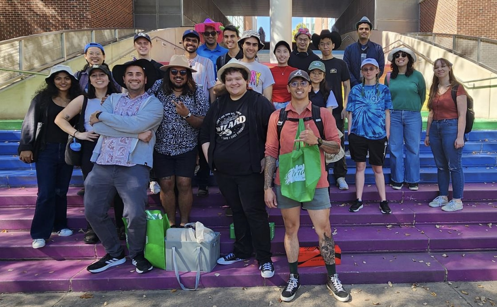

 

## Faculty

  

    
  

  

<a href="http://josiahhester.com/">Josiah Hester</a> is Associate Professor of Interactive Computing and Computer Science at Georgia Tech. He leads the Center for Advancing Responsible Computing at Georgia Tech’s College of Computing and is on the leadership team of the Brook Byers Institute for Sustainable Systems.
  

  

## Researchers

### Research Staff
- [Dr. Saad Ahmed](https://www.saadahmedch.com/)
- [Rachel Baker-Ramos](https://www.rachelbakerdesigner.com/)
- Gabriela Buraglia

### Postdoctoral Fellows

- [Dr. Alex Cabral](https://a-cabral.github.io/)
- Dr. Yaman Sangar
- [Dr. Sylvia H. Janicki](https://sylviahjanicki.com/)
- [Dr. Eren Yildiz](https://erenyildiz33.github.io/)
<!-- - [Dr. Zeyu Yan](https://zeyuyan.com/) -->

### Affiliated Researchers
- [Dr. Nicole Kennard](https://research.gatech.edu/people/nicole-kennard), Assistant Director for Community-Engaged Research at [BBISS](https://sustainablesystems.gatech.edu/)

## PhD, Masters, Honors and Undergraduate Students

### PhD Students

- [John Mamish](https://johnmamish.com/)
- [Christopher Kraemer](https://chrispkraemer.github.io/chrispkraemer/)
- [Blaine Rothrock](https://blainerothrock.com/)
- [Alex Curtiss](https://winnemaclabs.com/)
- [Rishabh Goel](https://www.rishgoel.com)
- [Eric Greenlee](https://ericgreenlee.github.io/)
- [Diana Wang](https://hello-diana.github.io/)
- [Yingting Gao](https://yingtinggao666.wixsite.com/design)
- [Tejonidhi Deshpande](https://tejodeshpande.github.io/)
- [Moeiini ‘Moi’ Reilly](https://moireilly.com/)
- [Britney Johnson](https://www.linkedin.com/in/britney-johnson-8b904555)
- [Connor Pan](http://pancjp.com/)
- [Ella Neumann](https://ellaneumann.com/)
- Haisley Kim
- [Jacob Cook](https://www.linkedin.com/in/jacob-cook-22181a175/)
- [Nikola Maruszewski](https://marusz.com/)
- Xinye Wang
- [Yibo Fu](https://yibo-fu.com)
- [Summit Shrestha](https://sites.google.com/view/summitshrestha/)

### Master Students

- Candace Boice
- Dharmik Patel
- [Tristan Daniel](https://tristan-daniel.netlify.app/)
- [Disha Sikaria](https://dishasikaria.com/)
- [Akanksha Tanwar](https://www.linkedin.com/in/akankshatanwar17/)
- [Anil Kumar Soma](https://www.linkedin.com/in/soma1809/)

### Honors and Undergraduate Students

- Ben Carter
- James Kemerait
- Simon Guterman
- Diego Shipmon
- Omer Inan
- Pichaya "Palm" Limprayoon

## Alumni

### PhD and Postdoctoral
- Dr. Rawan Alharbi (Apple)
- [Dr. Abu Bakar](https://www.linkedin.com/in/abu-bakar-764a4797/) (Qualcomm)
- [Dr. Sougata Sen](https://www.bits-pilani.ac.in/goa/sougata-sen) (Assoc. Prof at BITS Pilani)
- [Dr. Nivedita Arora](https://www.mccormick.northwestern.edu/research-faculty/directory/profiles/arora-nivedita.html) (Asst. Prof at Northwestern)
- [Dr. Tingyu Cheng](https://engineering.nd.edu/faculty/tingyu-cheng/) (Asst. Prof at Notre Dame)
- [Dr. Stefany Cruz](https://www.stefanylcruz.com/) (Postdoc, University of Washington)

### Masters
- Manas Mhasakar (Meta)
- Amith Tallanki (Microsoft)
- Michael Parkin (Lenovo)
- Panchami Kamath (Apple)
- Sydney Young (Emory Healthcare)
- Jahnavi Kolakaluri (Palantir)
- Viswak Raja (Ford)
- Will Gelder (CBORD)

### Undergratuate
- Bill Yen (PhD, Stanford)
- Amy Guo (Amazon)
- Alex Cindric (Rush Medical)
- Jason Liu (Meta)
- Alvin Tan (PhD, UC Berkeley)
- Zachary Englhardt (PhD, U Washington)
- Alexander Ross (PhD, TUM)
- Alexander Redding (PhD, UCSD)
- Julian Richey (Amazon)
- Chixiang Wang (PhD, Dartmouth)
- Logan Danek (Burro)
- Aaron-Patrick Empedrado (Hinge)
